# Unyielding Might

An Android gym app for booking expert-led fitness classes (free for members, pay-as-you-go for everyone else), backed by a Kotlin REST API.

<p>
  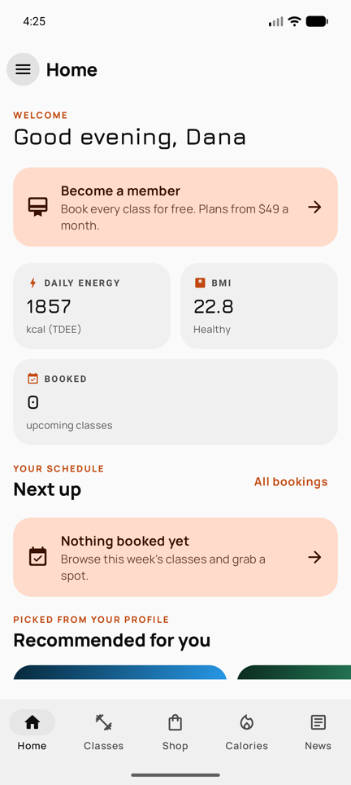
  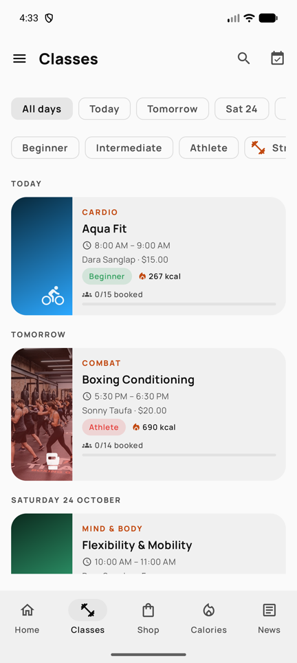
  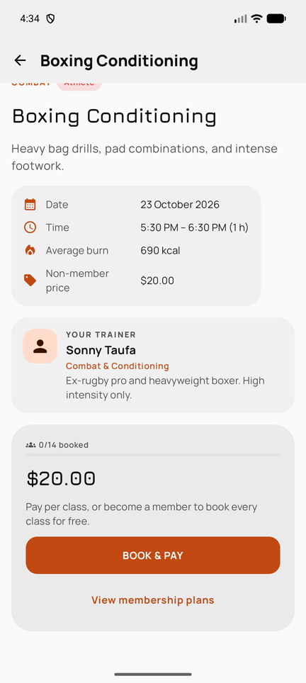
  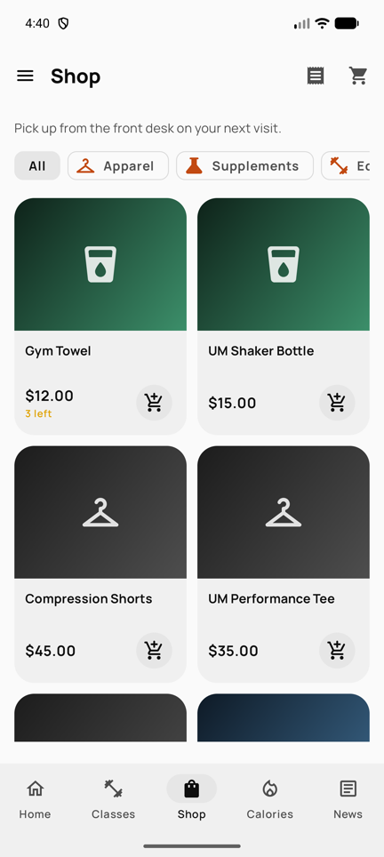
</p>

## Project

**Status:** Working end to end in local development: Android app, API server and MySQL database. Not deployed yet.

The app covers registration with email verification, class browsing and booking, Stripe payments (test mode), the shop, membership plans, a calorie burner, health and fitness news, and a full admin area. The API, the database schema and every screen were rebuilt from the original group project.

## Why I want to build it

Unyielding Might started as a group project. I wrote the backend and two teammates built the frontend and the technical documentation. We shipped a partial Java app that talked straight to SQL Server from the phone. I wasn't happy with how it turned out and knew I could take it much further on my own, so this is a ground-up rewrite. The goals:

- **Modern Kotlin everywhere:** Jetpack Compose on the phone, Ktor on the server, and a shared module for the code both sides use.
- **A real backend:** the phone no longer holds database, email or payment secrets.
- **Finish the features we planned but never built:** shop, profile in the sidebar, admin and user roles, class recommendations, calorie burner, news.
- **A UI that adapts to any screen size.** This was the biggest problem with the original.

## Current progress

| Area | Done |
| --- | --- |
| **API server** (Ktor) | JWT auth with bcrypt, email verification codes, password reset, profiles, classes and bookings (over-booking is prevented in the database), Stripe PaymentIntents with refunds, shop orders with stock control, membership plans, NewsAPI proxy with caching, admin CRUD and stats, newsletter, background job that completes finished classes |
| **Database** | Schema translated from SQL Server to MySQL 8 / MariaDB and normalised, with constraints and versioned migrations. Demo data is generated relative to today, so the schedule is never stale |
| **Android app** (Compose) | Responsive shell (bottom bar on phones, navigation rail, permanent drawer on tablets), registration wizard, Home with personalised recommendations, Classes, class detail with Stripe PaymentSheet, Shop and cart, Calorie burner, News, Settings (theme, units, newsletter), profile, membership, bookings, orders |
| **Admin** | Dashboard stats, create/edit/cancel/delete classes, attendees, trainers, shop items, user roles, newsletter |
| **Tests** | 58 automated tests: shared domain logic, API tests against an in-memory database, and app unit tests with a mocked HTTP engine. CI runs them on every push |

<p>
  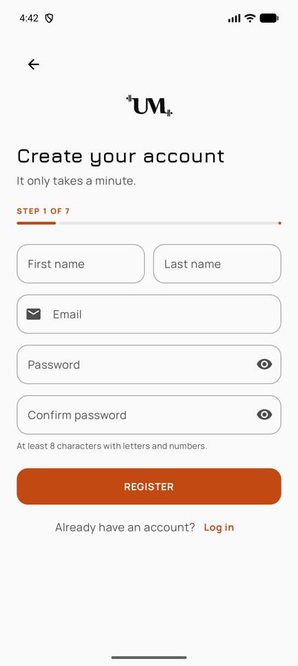
  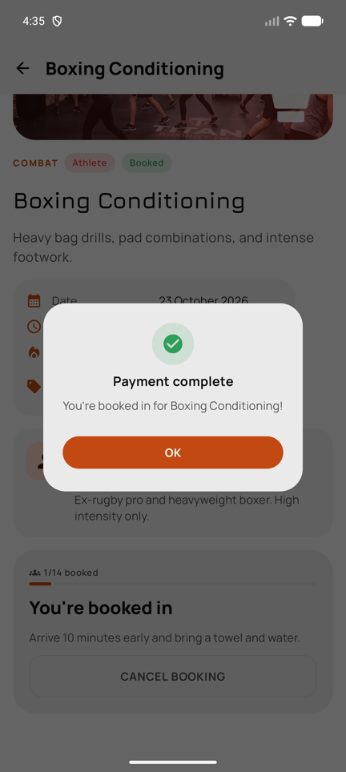
  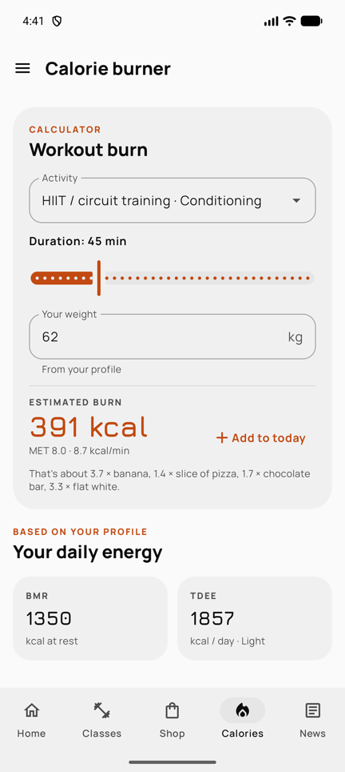
  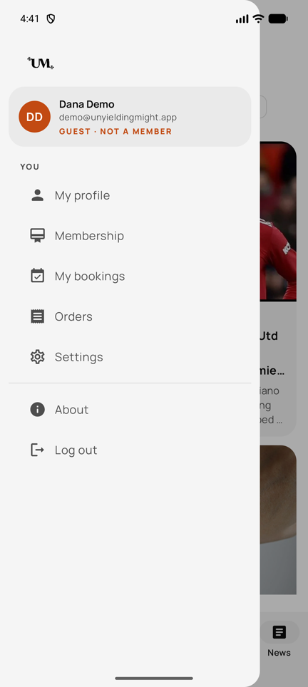
  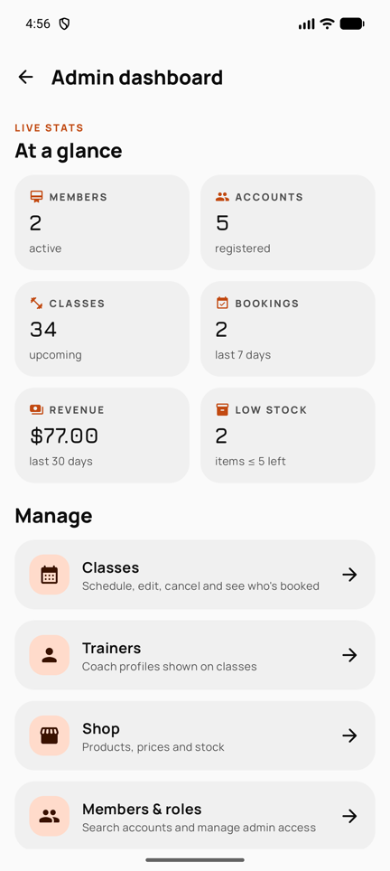
</p>
<p>
  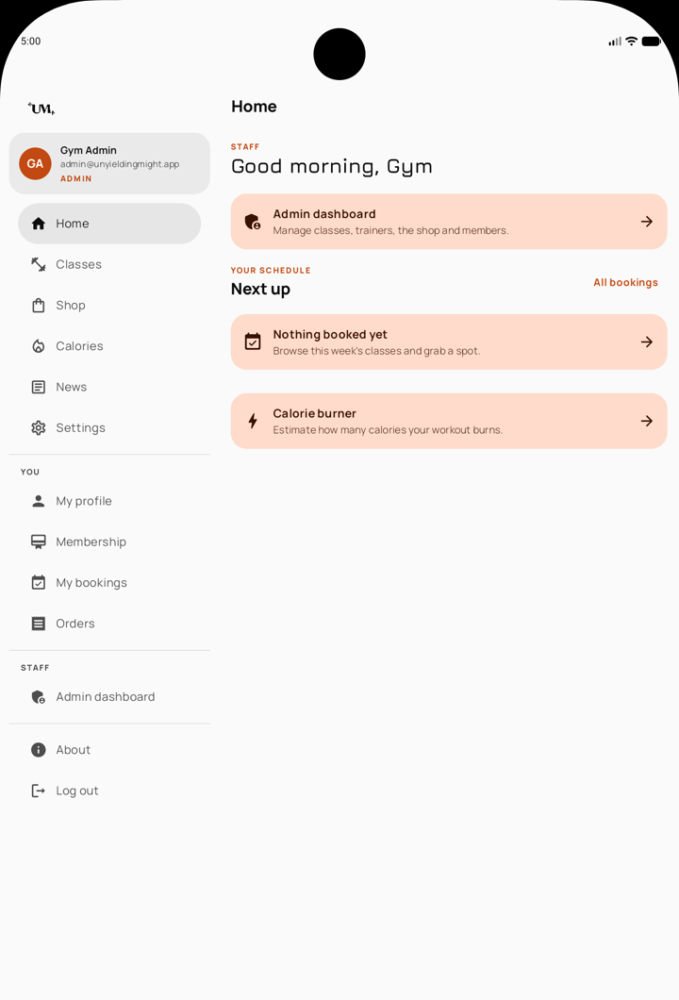
  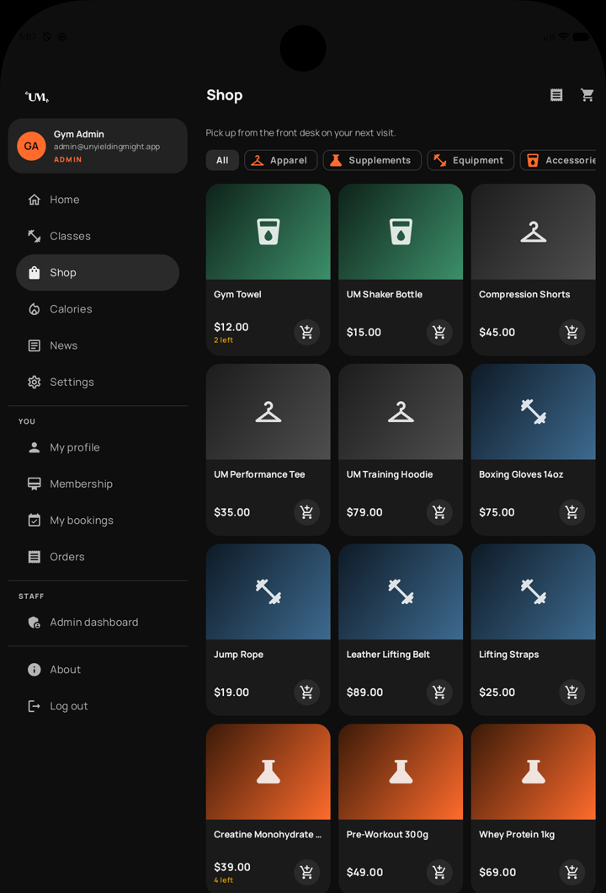
</p>

## Next tiny step

Deploy the API and database (Aiven MySQL plus a small container host), then point the release APK at it and attach the APK to a GitHub release.

## Tech stack

- **App:** Kotlin, Jetpack Compose, Material 3, Navigation Compose (type-safe routes), Ktor client, kotlinx.serialization, DataStore, Coil, Stripe Android PaymentSheet
- **Server:** Kotlin, Ktor (Netty), JWT, bcrypt, HikariCP and plain JDBC (MySQL Connector/J, MariaDB driver), Jakarta Mail, Stripe Java, NewsAPI, QuickEmailVerification
- **Shared module:** request/response models plus domain logic used by both sides (BMR/TDEE/BMI, MET-based calorie burner, class recommender, validation, unit conversion)
- **Database:** MySQL 8 (MariaDB locally works too), with Aiven planned for production
- **Testing & CI:** kotlin.test/JUnit, Ktor test host, H2 in MySQL mode, Ktor MockEngine, GitHub Actions
- **Build:** Gradle (Kotlin DSL) with a version catalog, AGP 9

## Ideas / future features

- Deploy to Aiven MySQL and a hosted API, with Stripe webhooks for payment confirmation
- Waitlists for full classes, with automatic promotion when a spot frees up
- Recurring class templates so admins don't schedule week by week
- Push notifications (the notification system uses the Observer pattern, so a push channel can subscribe next to email)
- Product photos and image upload for the shop
- Member check-in with a QR code at the front desk
- A showcase website on GitHub Pages
- Compose UI tests and screenshot tests

---

## Architecture

```
┌─────────────────────┐   HTTPS / JSON    ┌──────────────────────────┐   JDBC   ┌──────────────┐
│ Android app         │ ────────────────▶ │ Ktor API server          │ ───────▶ │ MySQL 8      │
│ Compose + MVVM      │  JWT bearer token │ routes → services → repo │          │ (Aiven)      │
│ Stripe PaymentSheet │ ◀──────────────── │ Stripe · SMTP · NewsAPI  │          └──────────────┘
└─────────────────────┘                   └──────────────────────────┘
           ▲                                          ▲
           └──────────── shared Kotlin module ────────┘
                 (DTOs, fitness maths, recommender)
```

- **`app/`**: single-activity Compose app. Each screen has a ViewModel; a small `AppContainer` provides the API client, session, preferences, cart and the app-wide message modal.
- **`server/`**: `routes` handle HTTP, `service` holds business rules, and `repo` holds SQL. Payments go through a `PaymentGateway` interface (Stripe, or a mock when no key is set), and the server always re-checks a payment with Stripe before fulfilling it.
- **`shared/`**: pure Kotlin with no Android or server dependencies, so it's easy to test.

Design patterns carried over from the original project: Observer (gym events → email notifications) and Singleton-style dependency containers. The Adapter pattern from the RecyclerView days is now handled by Compose lazy lists.

## Running it locally

**Prerequisites:** Android Studio (latest stable), JDK 17+, and a MySQL 8 or MariaDB server.

1. **Database.** Either start the bundled container with `docker compose up -d` (MySQL on port 3307), or use an existing MySQL/MariaDB and create an empty `unyielding_might` database. The server creates the tables and demo data on first start.

2. **Configuration.** Add the following to `local.properties` in the project root (it's git-ignored). Environment variables with the same names override it.

   ```properties
   MYSQL_URL=jdbc:mysql://localhost:3307/unyielding_might   # or jdbc:mariadb://localhost:3306/...
   MYSQL_USER=um_app
   MYSQL_PASSWORD=...
   JWT_SECRET=any-long-random-string

   # Optional. Each feature falls back gracefully when its key is missing.
   STRIPE_SECRET_KEY=sk_test_...        # without it, payments run in a simulated "mock" mode
   STRIPE_PUBLISHABLE_KEY=pk_test_...
   NEWS_API_KEY=...                     # without it, the News tab shows a friendly message
   SMTP_HOST=smtp.gmail.com
   SMTP_PORT=465
   SMTP_USER=...
   SMTP_PASS=...                        # without SMTP, verification codes are printed in the server log
   LOG_OTP_CODES=true                   # also print codes when SMTP is on (development only)
   ```

3. **Start the API:** `./gradlew :server:run`. It listens on http://localhost:8080.

4. **Run the app** from Android Studio on an emulator. It reaches the host machine at `http://10.0.2.2:8080`. For a physical device, set `API_BASE_URL=http://<your-pc-ip>:8080/` in `local.properties`.

**Demo accounts** (password `password123`):

| Email | Role |
| --- | --- |
| `admin@unyieldingmight.app` | Admin |
| `member@unyieldingmight.app` | Customer with an active membership (classes are free) |
| `demo@unyieldingmight.app` | Customer without a membership (classes are paid) |

To try linking a membership during registration, register as `newmember@unyieldingmight.app` and enter membership ID `1001`.

**Stripe test card:** `4242 4242 4242 4242`, any future expiry date, any CVC.

## Tests

```bash
./gradlew :shared:test :server:test        # domain logic + API tests (in-memory H2, no database needed)
./gradlew :app:testDebugUnitTest           # app unit tests
```

## Credits

Unyielding Might began as a group project. This rewrite builds on the original team's design, user flows and class content:

- [d-ustindwayne](https://github.com/d-ustindwayne): backend (original), and the Kotlin, Ktor and Compose rewrite
- [SaplingBeing](https://github.com/SaplingBeing): frontend and technical documentation (original)
- [darawesome](https://github.com/darawesome): frontend and technical documentation (original)

News headlines are provided by [NewsAPI.org](https://newsapi.org).

## License

MIT. See [LICENSE](LICENSE).
